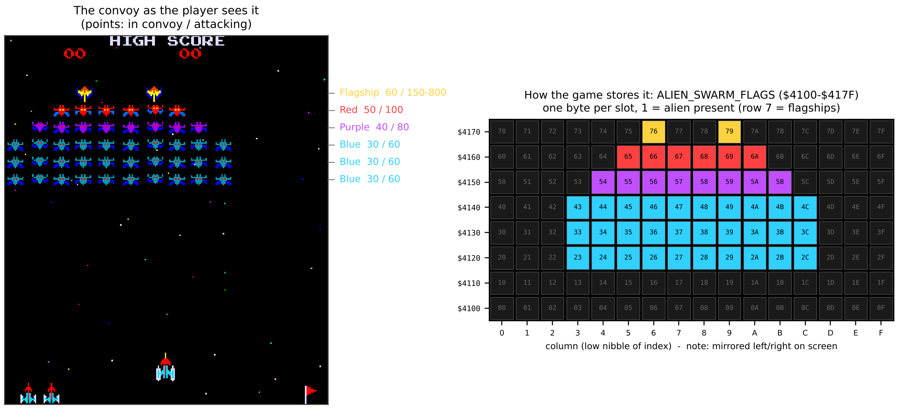
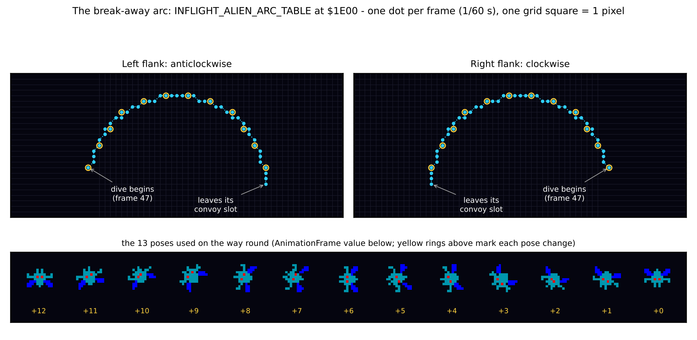
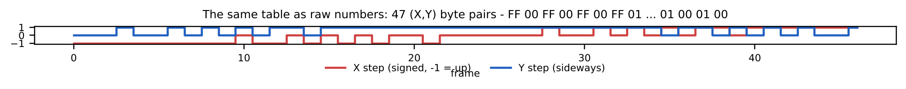
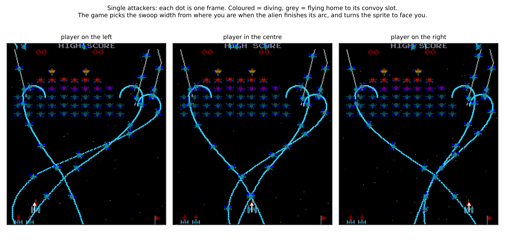
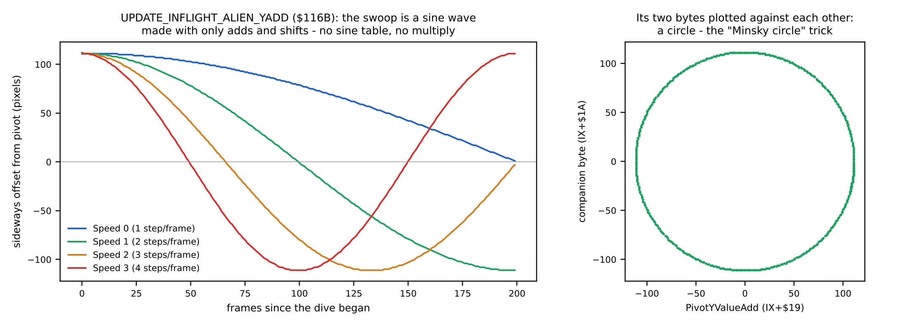
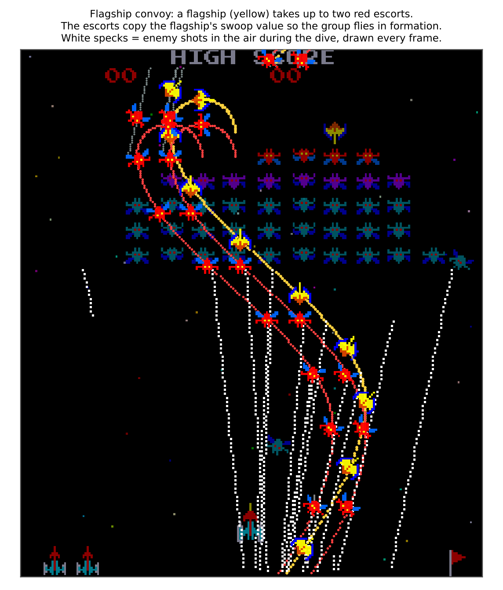
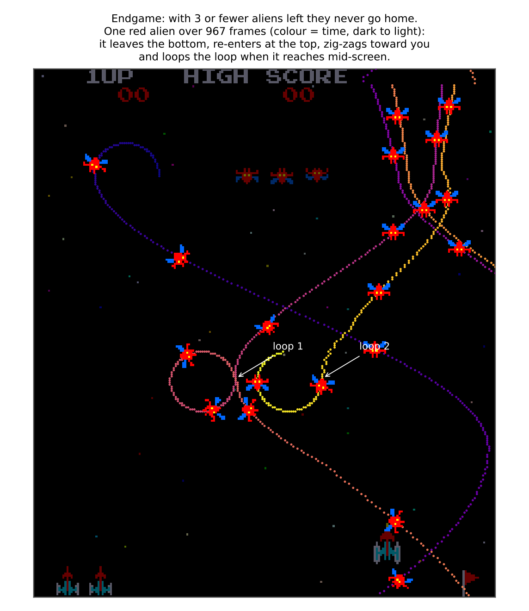

# Galaxian Flight Patterns

**How the aliens of Namco's 1979 arcade game fly, drawn from the game's own code.**

Galaxian was one of the first games where enemies broke out of formation and swooped at the
player. Players learned the swoops by eye. This page draws them.

Every dotted line here is a **real path**. To make them, a Python port of the game was run and
each attacking alien's position was logged on every frame (1/60 of a second). The port was
translated routine by routine from the original Z80 program. Dots that bunch together mean the
alien is moving slowly; dots that spread out mean it is moving fast.

> **Reading the coordinates.** The monitor is mounted sideways in the cabinet. The game's **X**
> therefore runs *down* the screen and its **Y** runs *across*, with Y getting bigger towards the
> left. Addresses such as `$1E00` refer to the original ROM and RAM layout, so you can follow
> along in the [disassembly](http://seanriddle.com/galaxian.asm).

## Contents

1. [The convoy](#1-the-convoy)
2. [Leaving the convoy: the arc](#2-leaving-the-convoy-the-arc)
3. [The dive](#3-the-dive)
4. [The swoop is a sine wave, without any sine](#4-the-swoop-is-a-sine-wave-without-any-sine)
5. [Flagship convoys](#5-flagship-convoys)
6. [The endgame: no going home](#6-the-endgame-no-going-home)
7. [An attacker's life, as a state machine](#7-an-attackers-life-as-a-state-machine)
8. [Sources and method](#sources-and-method)

---

## 1. The convoy

The convoy has forty-six aliens: 2 flagships, 6 red, 8 purple and 30 blue.

| Alien | In the convoy | Attacking |
|---|---:|---:|
| Flagship | 60 | 150 / 200 / 300 / 800 |
| Red | 50 | 100 |
| Purple | 40 | 80 |
| Blue | 30 | 60 |

- In memory the convoy is a 16×8 grid of one-byte flags, `ALIEN_SWARM_FLAGS` at `$4100-$417F`.
  Row 7 holds the flagships.
- In a two-player game, each player's grid is packed into 16 bytes, one bit per slot, and saved
  while the other player has their turn.
- The whole convoy drifts sideways one pixel every 4 frames. The aliens aren't sprites while in
  the convoy: they are characters, and the drift works by scrolling the character columns they
  are drawn in.
- While your shot is passing through a column that still has aliens in it, the convoy stops
  drifting.

---

## 2. Leaving the convoy: the arc

When an alien is picked to attack, its characters are wiped from the convoy and it becomes a
sprite. For the next 47 frames it follows the table at **`$1E00`**, `INFLIGHT_ALIEN_ARC_TABLE`.
The table holds 47 pairs of tiny steps. Each pair moves the alien at most one pixel up or down and
at most one pixel sideways. Read in order, the steps climb, curl over and drop.

Every 4 frames the sprite turns to its next pose; the first change comes after 3 frames. Thirteen
poses take it from hanging upside-down in the convoy, bat-style, to facing straight down.

The same 94 bytes serve both flanks: the sideways steps are simply added or subtracted. They are
also reused, applied in reverse, for the [loop-the-loop](#6-the-endgame-no-going-home).

The side an attacker leaves from is chosen every frame. If the convoy is near the end of its
sideways drift, the side is fixed; otherwise the game tosses a coin.

**Who gets picked?**

- A bank of 16 countdown timers decides when a single alien attacks. The timers are reloaded from
  the table at `$15E3`.
- The difficulty level sets how many of the timers run, from 1 to 15.
- The attacker comes from the outermost occupied column on the chosen flank. The game looks at
  the purple row first and works down. If no flagships are left, it tries the red row first.

---

## 3. The dive

When the arc ends, the alien looks at where *you* are and commits to a swoop:

- **Swing:** its sideways swing is set to half its distance from you, plus 16 pixels, clamped
  between 48 and 112.
- **Pivot:** a pivot point is chosen so the swing starts from where the alien already is.
- **Movement:** from then on it drops exactly one pixel per frame. Its sideways position is the
  pivot plus a smoothly swinging offset (see the next section).
- **Facing:** each frame the sprite is also turned to face you. The angle comes from a little
  shift-and-subtract division routine at `$0048`.

Near your ship the alien speeds up to 1-2 pixels a frame and flies off the bottom. It then
reappears at the top and glides back down into its own slot. The grey dots show that return; the
slot keeps moving as the convoy drifts.

**Shooting** is just as rule-based:

- An attacker can only fire when its height is exactly on one of a few invisible lines, 25 pixels
  apart, starting at 157.
- There are three such lines while the bottom rows of the convoy are full. More appear as you
  clear rows, up to six.
- Each shot is aimed at you, plus a random spread.

---

## 4. The swoop is a sine wave, without any sine

A Z80 has no multiply instruction and no floating point, yet the dives are smooth S-curves.

The routine at **`$116B`**, `UPDATE_INFLIGHT_ALIEN_YADD`, keeps two numbers: the sideways offset
and a partner value. On every step it nudges the offset by a fraction of the partner. Then it
nudges the partner the other way, by a fraction of the *new* offset. That is all.

The pair goes round in a circle, so the offset traces a sine wave. The trick is known as the
**"Minsky circle"** algorithm, and it is also why the curve never drifts or grows. To keep a
value from crossing the 8-bit sign boundary (`$80`), the routine simply cancels that step.

An alien's **speed** is how many of these steps it takes per frame. Speed changes how far round
the wave the alien gets during its dive of roughly 140 frames. Slow aliens make one lazy curve;
fast ones swing back the other way into a full S.

The speeds come from the table at `$1DD1` and vary by row. The middle blue row is quicker than
the blue rows above and below it:

| Row | Alien | Swing speed (`$1DD1`) | Steps per frame |
|---:|---|---:|---:|
| 2 | blue (bottom) | 1 | 2 |
| 3 | blue (middle) | 2 | 3 |
| 4 | blue (top) | 1 | 2 |
| 5 | purple | 3 | 4 |
| 6 | red | 2 | 3 |
| 7 | flagship | 2 | 3 |

---

## 5. Flagship convoys

  

- **Timers:** flagships run on their own timers (`$4245`, `$4246` and `$422F`).
- **Escorts:** when a flagship launches, the game checks the three red slots nearest it and takes
  up to two of them as escorts.
- **Formation:** each red escort copies the flagship's swing value instead of working out its
  own. That is what keeps the group together.
- **Scoring:** shooting the flagship in flight scores:

  | Escorts | Points |
  |---|---:|
  | none | 150 |
  | one | 200 |
  | two | 300 |
  | two, both shot before the flagship | 800 |

- **Shock:** shooting a flagship in flight also "shocks" the convoy. No aliens leave and no
  attacker fires until a 240-frame counter runs out, and that counter only ticks while the sky is
  clear.
- **Escape:** a flagship that reaches the bottom with no escort escapes. Up to two escapees come
  back as extra flagships in the next wave.

---

## 6. The endgame: no going home

  

Attackers stop going home once three or fewer aliens remain in the convoy, or once all the blue
and purple aliens are gone. From then on:

1. Each time an attacker leaves the bottom of the screen, it reappears at the top at a random
   offset.
2. It drifts towards you for 40 frames without firing, then charges.
3. If it is inside the middle box of the screen (both coordinates between 96 and 159), it
   **loops the loop**: the arc table run backwards for 270°, then forwards for the last 90°.
4. Otherwise it veers at full speed for 100 frames and checks again.
5. After four sorties in a row it starts to **hug** you: its pivot creeps one pixel towards you
   every other frame. After the fifth sortie it creeps every frame.

---

## 7. An attacker's life, as a state machine

Each of the 7 flying aliens has a 32-byte record. A single byte in it (offset 2, `StageOfLife`)
selects which routine moves the alien on this frame. All of the behaviour above comes from these
13 small routines handing the alien from one stage to the next.

| Stage | Routine | What the alien does |
|---:|---|---|
| 0 | `PACKS_BAGS` | sets its colour, speed and sprite; is wiped from the convoy |
| 1 | `FLIES_IN_ARC` | flies the 47-frame arc from `$1E00`, turning to face down |
| 2 | `READY_TO_ATTACK` | chooses its swing and pivot from the player's position (reds copy the flagship) |
| 3 | `ATTACKING_PLAYER` | drops 1 px per frame with a sine swing; faces and shoots at the player |
| 4 | `NEAR_BOTTOM` | speeds up to 1-2 px per frame |
| 5 | `REACHED_BOTTOM` | wraps to the top, then goes home, keeps attacking, or escapes (a lone flagship) |
| 6 | `RETURNING_TO_SWARM` | glides down into its slot, turning upside-down |
| 7 | `CONTINUING_ATTACK_RUN` | endgame: homes in on the player for 40 frames |
| 8 | `FULL_SPEED_CHARGE` | loops if it is mid-screen; otherwise veers at top speed |
| 9 | `ATTACKING_AGGRESSIVELY` | as stage 3, but hugs the player after 4 sorties |
| 10 | `LOOP_THE_LOOP` | flies 270° of the arc table, reversed |
| 11 | `COMPLETE_LOOP` | flies the last 90° (the normal arc) |
| 12 | *(unnamed, `$1091`)* | goes back to `FULL_SPEED_CHARGE` |
| 13-15 | `CONVOY_CHARGER...` | used only by the score-table sprites in attract mode |

The record table has 8 slots, numbered 0 to 7. Slots 1-7 hold the flying aliens, so at most
seven can be in the air at once:

| Slot | Used for |
|---|---|
| 0 | only the explosion when you hit an alien still in the convoy |
| 1 | a flagship |
| 2-3 | the flagship's escorts |
| 4-7 | single attackers; the difficulty level sets how many of these may be used |

---

## Sources and method

- **Game:** Galaxian © 1979 Namco. The screen graphics in these figures are the game's own,
  shown here for the purpose of commentary.
- **Disassembly:** routine names and addresses follow Scott Tunstall's commented disassembly,
  [seanriddle.com/galaxian.asm](http://seanriddle.com/galaxian.asm). It was checked byte for
  byte against the MAME `galaxian` ROM set.
- **Recording the paths:** the paths were recorded from a Python port of that code. The player
  was made invulnerable and never fired, so that every flight could be seen from start to finish.
- **Chosen examples:** loop-the-loops are rare, so for the endgame figure several player positions
  were tried and the run that produced two loops was kept.
